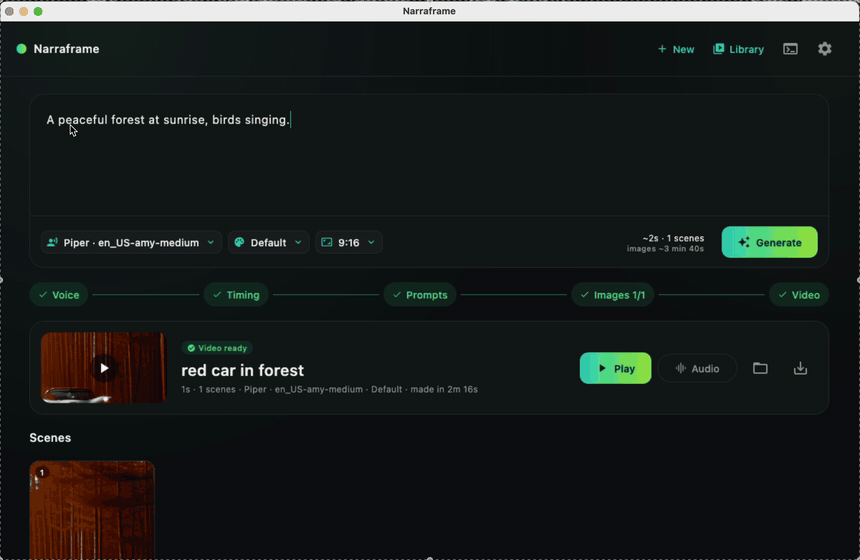
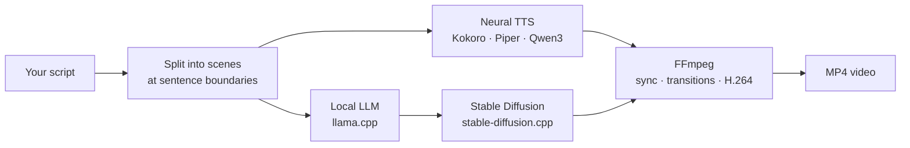

<div align="center">

# Narraframe

### Local AI text-to-video studio built with Kotlin Multiplatform

**Turn any script into a narrated video — stories, documentaries, explainers.<br>
100% on-device AI. No cloud, no API keys, no subscription.**

[](https://github.com/zekierciyas/narraframe/releases/latest)
[](LICENSE)
[](https://kotlinlang.org)
[](https://www.jetbrains.com/kotlin-multiplatform/)
[](https://www.jetbrains.com/compose-multiplatform/)
[-000000?logo=apple)](#platform-support)
[](CONTRIBUTING.md)
[](https://github.com/zekierciyas/narraframe/stargazers)

<!-- Demo GIF: docs/media/demo.gif -->


[**Download for macOS**](https://github.com/zekierciyas/narraframe/releases/latest) ·
[How it works](#how-it-works) ·
[Build from source](#build-from-source) ·
[Contributing](#contributing)

</div>

---

## What is Narraframe?

Narraframe is an open-source **desktop app written in Kotlin with Kotlin Multiplatform (KMP)
and Compose Multiplatform**. You paste a script, press **Generate**, and a few minutes later
you have an MP4: a natural voice reads your text, and every scene is illustrated by an AI image
that matches what is being said.

Everything runs **locally on your own computer**:

- a local **LLM** (llama.cpp) writes one image prompt per scene,
- **Stable Diffusion** (stable-diffusion.cpp) draws each scene on your GPU,
- a neural **text-to-speech** engine (Kokoro, Piper or Qwen3-TTS) records the narration,
- **FFmpeg** cuts it into a video with transitions, synced sentence by sentence.

As far as we know, Narraframe is one of the first open-source **Kotlin Multiplatform**
projects that runs a complete local AI pipeline — LLM, diffusion model and neural TTS — in a
single native desktop app. If you are curious how far **KMP** and **Compose Multiplatform**
can go beyond mobile, this repository is a hands-on example.

## Features

| | |
|---|---|
| 🎬 **Script → video in one click** | Paste text, press Generate, watch the storyboard fill in live. |
| 🔒 **Private and offline** | No account, no API keys, nothing leaves your machine. |
| 🗣️ **Natural voices** | Kokoro (default), Piper (bring your own `.onnx` voice), Qwen3-TTS with voice design, or your system voices. Preview before you generate. |
| 🖼️ **Scene-accurate images** | The script is split at sentence boundaries; each scene gets its own prompt and image. |
| 🎯 **Perfect audio sync** | Every image stays on screen exactly as long as its sentence is spoken. |
| ⚡ **GPU accelerated** | Metal on Apple Silicon, with a persistent image engine and a fast LCM model (~5 s per image on an M3). |
| 🎨 **Styles and formats** | Cinematic, Anime, Watercolor, Sketch… in 16:9, 9:16 (Shorts/Reels/TikTok), 1:1, 4:3, 3:4. |
| 🧙 **Guided setup** | A first-launch wizard picks and downloads the models; engines can live on an external drive. |
| 📚 **Library and resume** | Every video gets its own folder; interrupted renders continue where they stopped. |

## How it works



Narration and images are produced **in parallel**. Each scene is voiced separately, so the
video knows the exact length of every sentence and switches images right on the sentence boundary.

## Download

1. Download the latest **`Narraframe-x.y.z-macos-arm64.dmg`** from
   [Releases](https://github.com/zekierciyas/narraframe/releases/latest).
2. Open the DMG and drag **Narraframe** into **Applications**.
3. The app is not notarized by Apple yet, so clear the quarantine flag once:
   ```shell
   xattr -cr /Applications/Narraframe.app
   ```
4. Open Narraframe. The setup wizard shows exactly what it will download (about 3–4 GB of models)
   and where to store it — an external drive works too.

**Recommended:** Apple Silicon Mac (M1 or newer), 16 GB RAM, ~6 GB free disk space.

## Platform support

| Platform | Status |
|---|---|
| macOS · Apple Silicon | ✅ **Tested** — this is where Narraframe is developed and used today |
| macOS · Intel | ⚠️ Untested |
| Windows | 🧪 Code paths exist (CUDA / Vulkan / CPU engines) but are **not tested yet** |
| Linux | 🧪 Code paths exist (CUDA / Vulkan / CPU engines) but are **not tested yet** |

Narraframe has **only been tested on macOS so far**. Thanks to Kotlin Multiplatform and Compose
Multiplatform the same codebase can target Windows and Linux — help testing them is very welcome.

## Build from source

Requirements: **JDK 17+** (Gradle downloads everything else).

```shell
git clone https://github.com/zekierciyas/narraframe.git
cd narraframe
./gradlew :composeApp:run
```

Build a native app bundle or installer:

```shell
./gradlew :composeApp:createDistributable          # .app bundle
./gradlew :composeApp:packageDistributionForCurrentOS  # DMG / MSI / DEB
```

Run one generation without the UI (handy for testing engines and measuring speed):

```shell
./gradlew :composeApp:run -PheadlessScript=script.txt -PheadlessOut=/tmp/narraframe-out
```

## Tech stack

| Layer | Technology |
|---|---|
| Language | **Kotlin 2.3** |
| App framework | **Kotlin Multiplatform (KMP)** · **Compose Multiplatform** (Material 3, desktop / JVM target) |
| Concurrency | Kotlin Coroutines |
| Text model | [llama.cpp](https://github.com/ggml-org/llama.cpp) with GGUF models (Llama 3.2, Phi-3.5) or Ollama / LM Studio |
| Image model | [stable-diffusion.cpp](https://github.com/leejet/stable-diffusion.cpp) · DreamShaper 8 LCM, Stable Diffusion 1.5 / 2.1 (GGUF) |
| Voice | [Kokoro](https://github.com/thewh1teagle/kokoro-onnx) · [Piper](https://github.com/OHF-Voice/piper1-gpl) · Qwen3-TTS · OS voices |
| Video | [FFmpeg](https://ffmpeg.org) with VideoToolbox hardware encoding |

```
composeApp/src/
  commonMain/   Kotlin Multiplatform shared code: Compose UI, view models, pipeline, engine wrappers
  desktopMain/  JVM code: engine downloaders, GPU detection, sd-server, FFmpeg, Python voice sidecar
```

## Where your data lives

- Settings are stored locally (JVM `Preferences`).
- Engines and models go to the folder you choose during setup (default `~/.narraframe/`).
- Videos go to your library folder (default `~/Movies/Narraframe`), one folder per video
  with the narration, images, prompts and MP4.
- Logs: `~/.narraframe/logs/`.

## Roadmap

- [ ] Tested Windows and Linux releases (CUDA / Vulkan)
- [ ] Apple notarized DMG
- [ ] Per-scene editing: re-roll a single image, edit a prompt
- [ ] Background music and subtitles
- [ ] More languages for narration

## Contributing

Narraframe is **open to contributions** of every size — bug reports, testing on Windows and
Linux, new models and voices, UI polish, documentation. It is also a friendly place to learn
**Kotlin Multiplatform** and **Compose Multiplatform** on a real desktop app.

1. Read the [contributing guide](CONTRIBUTING.md) and the [Code of Conduct](CODE_OF_CONDUCT.md).
2. Pick an issue (look for `good first issue`) or open one to discuss your idea.
3. Open a pull request.

If Narraframe is useful or interesting to you, please **⭐ star the repository** — it helps
other Kotlin and local-AI developers find it.

## Security

Found a security problem? Please report it privately as described in the
[security policy](SECURITY.md), not as a public issue.

## License

[MIT](LICENSE) © 2026 Zeki Erciyas and Narraframe contributors

Narraframe downloads third-party engines and models at run time; each keeps its own license.
See [THIRD_PARTY_NOTICES.md](THIRD_PARTY_NOTICES.md) for the full list.

---

<sub>Keywords: Kotlin Multiplatform, KMP, Compose Multiplatform, Kotlin desktop app, local AI,
offline AI, on-device AI, AI video generator, text to video, script to video, Stable Diffusion,
llama.cpp, stable-diffusion.cpp, text-to-speech, Kokoro TTS, Piper TTS, faceless YouTube video,
open source, macOS, Apple Silicon.</sub>
